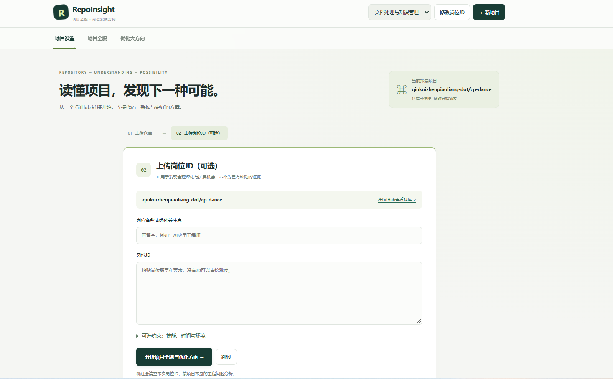
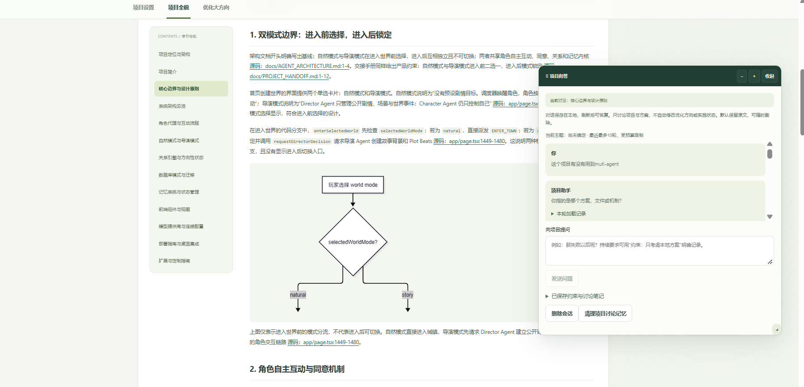
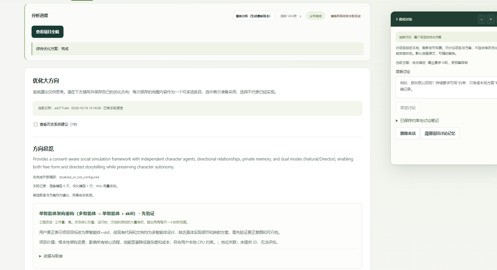
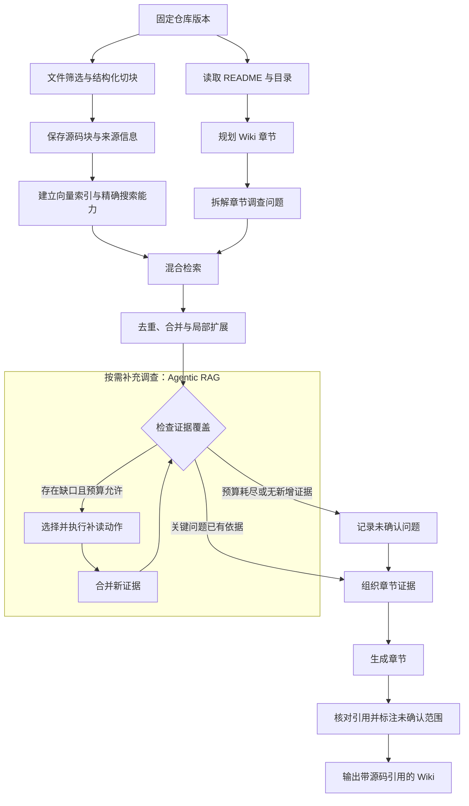
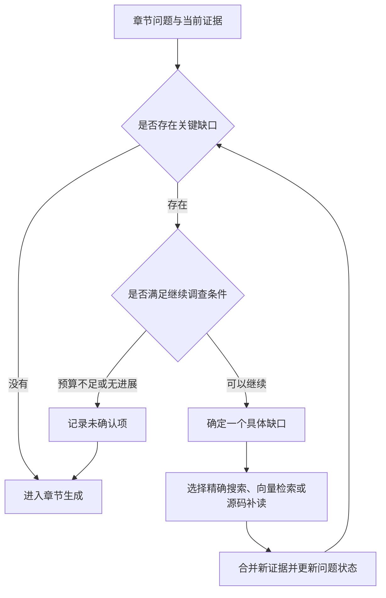
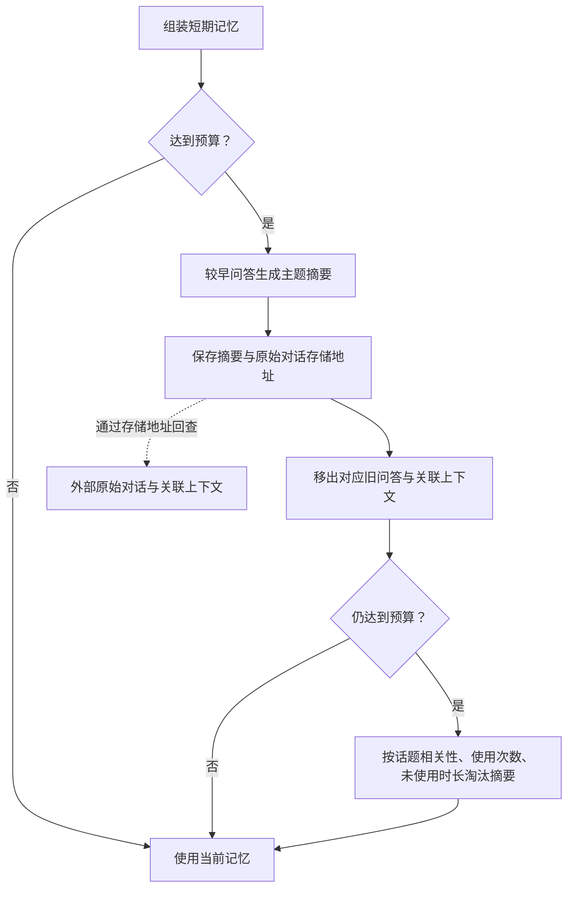
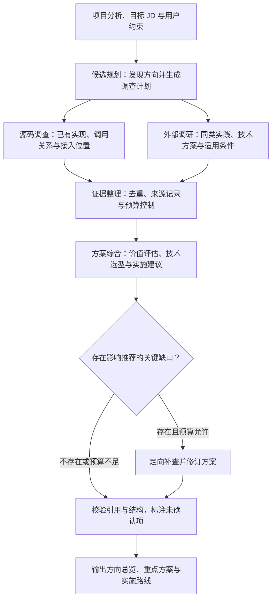
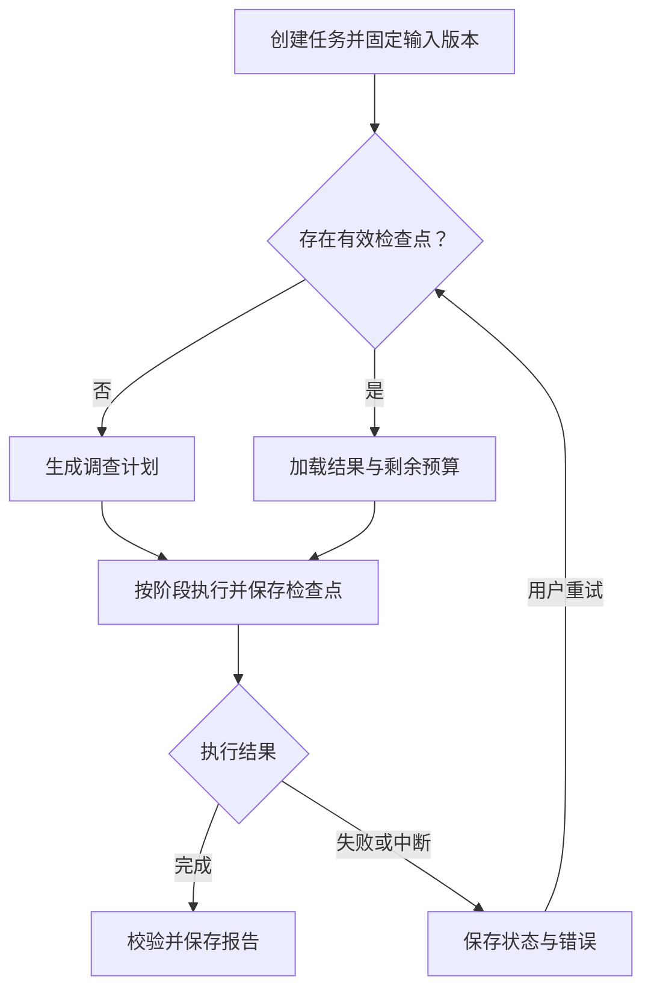

# RepoInsight

**读懂开源项目，结合岗位要求，找到值得实施的优化方向。**

[项目仓库](https://github.com/RRX12/RepoInsight)

## 安装与配置

### 1. 安装与准备

当前启动脚本面向 **Windows PowerShell**。请先安装：

- Python **3.12**（已验证版本），确保 `python` 可用。
- Git、Node.js **22 LTS**、pnpm **11.25.0**，确保命令可用。可用 `npm install -g pnpm@11.25.0` 安装 pnpm。
- Ollama：以下配置用它在本地计算 embedding；文本生成使用 DeepSeek API。

```powershell
git clone https://github.com/RRX12/RepoInsight.git
cd RepoInsight
powershell -ExecutionPolicy Bypass -File scripts/start.ps1 -SetupOnly
```

首次执行会创建 `.venv`、按锁文件安装后端／前端依赖、构建网页，并在不存在时复制 `.env.example` 为 `.env`。已有配置不会被覆盖。依赖或前端代码更新后加 `-Install` 重新安装并构建：

```powershell
powershell -ExecutionPolicy Bypass -File scripts/start.ps1 -Install -SetupOnly
```

Python、Git、Node.js、pnpm、Ollama 需要自行安装；脚本不会安装系统软件。下面的 DeepWiki 服务也需要首次配置一次。

### 2. 安装项目分析服务

RepoInsight 通过本地 **DeepWiki-Open sidecar** 生成 Wiki 和处理项目问答，增强模式复用其任务服务并加入结构分块、源码检索和工具调用。目前增强生成链支持 **公开 GitHub 仓库＋DeepSeek**。

在仓库根目录执行（固定版本，勿直接换成上游最新分支）：

```powershell
git clone https://github.com/AsyncFuncAI/deepwiki-open.git data/deepwiki-open
git -C data/deepwiki-open checkout d92819a9c9f3b99416e3580ff235fc9d3adf8b89
git -C data/deepwiki-open apply ../../scripts/deepwiki-local.patch
python -m venv data/deepwiki-venv
data/deepwiki-venv/Scripts/python -m pip install -r scripts/deepwiki-requirements.lock.txt
.venv/Scripts/python scripts/configure-deepwiki.py --sidecar data/deepwiki-open
.venv/Scripts/python scripts/install-deepwiki-retrieval.py --sidecar data/deepwiki-open --wiki-rag
ollama pull nomic-embed-text
```

`configure-deepwiki.py` 只用于首次配置，已有 sidecar `.env` 时会拒绝覆盖。更新本仓库补丁后重新执行最后的 `install-deepwiki-retrieval.py` 命令并重启 sidecar；安装器会检查上游版本及未知修改，不会自动覆盖不兼容改动。

### 3. 配置模型

两份 `.env` 均在本地编辑，**不要提交 API Key**。

在根目录 `.env` 设置：

```dotenv
REPOINSIGHT_DEMO=false
DEEPWIKI_BASE_URL=http://127.0.0.1:8002
DEEPWIKI_PROVIDER=deepseek
DEEPWIKI_MODEL=你的DeepSeek模型ID
WIKI_RETRIEVAL_MODE=enhanced
WIKI_RAG_INDEX_MODE=auto
WIKI_RAG_AUTO_VECTOR_LIMIT=10000
PROJECT_MODEL=你的DeepSeek模型ID
```

在 `data/deepwiki-open/.env` 中保留初始化生成的配置，并添加：

```dotenv
DEEPSEEK_API_KEY=你的APIKey
DEEPSEEK_BASE_URL=https://api.deepseek.com
```

模型 ID 必须是账户实际支持的名称，并支持工具调用。Wiki 使用 `DEEPWIKI_MODEL`；优化分析与讨论使用 `PROJECT_MODEL`，默认读取 sidecar 中的 DeepSeek Key 与地址。如需独立配置，在根目录设置 `PROJECT_MODEL_API_KEY` 和 `PROJECT_MODEL_BASE_URL`，无需重复配置同一密钥。

**Embedding 与文本模型是两种配置**：以上初始化使用本地 Ollama 的 `nomic-embed-text`，不是让 DeepSeek 生成向量。保持 Ollama 运行；首次索引较慢，后续复用缓存，仅计算缺失输入。切换 embedding 模型会产生新的索引身份。其他 embedding 服务配置见 sidecar 的 `api/config/embedder.json`，本 README 不假定不同服务参数通用。

可选：根目录 `GITHUB_TOKEN` 用于 GitHub API 访问额度；当前增强流程仍以公开仓库为范围。

预算由根目录 `WIKI_RAG_*` 控制，完整选项见 [.env.example](.env.example)。`auto` 模式最多生成 `WIKI_RAG_AUTO_VECTOR_LIMIT` 个缺失向量；这不是 token 数。`WIKI_RAG_INPUT`／`WIKI_RAG_OUTPUT` 分别控制章节输入估算与输出预算，模型自身上限仍有效。文本 API 可能收费；提高预算可能增加费用和等待时间。

#### 可选：优化建议的外部资料调研

在根目录.env设置 `OPTIMIZATION_WEB_ENABLED=true`、`TAVILY_API_KEY=你的Key`。普通搜索可能按服务商额度收费，默认关闭；未配置时仍可基于源码生成受限规划，并标明未完成外部调研。搜索与已读正文各默认最多6次；缓存24小时，可用 `OPTIMIZATION_WEB_REFRESH=true` 强制刷新。优化规划默认2次主要模型调用，可选一次补查修订及一次格式修复；首次源码准备和Wiki另计，不是整个分析仅两次。全部参数见.env.example。

### 4. 启动

保持 Ollama 运行，然后在两个终端分别执行：

```powershell
# 终端一：Wiki 服务
powershell -ExecutionPolicy Bypass -File scripts/start-deepwiki.ps1
```

```powershell
# 终端二：RepoInsight（缺少应用依赖时自动安装）
powershell -ExecutionPolicy Bypass -File scripts/start.ps1
```

打开 **http://127.0.0.1:8000/**。网页由后端提供，无需额外启动前端开发服务器。两个终端各按 `Ctrl+C` 停止对应服务。不要开启多个后端 worker。

修改 `.env` 后重启对应服务；修改网页后执行 `start.ps1 -Install` 重新构建。开发前端时可单独运行 `pnpm --dir frontend run dev`（5173 端口）。


## 项目介绍

面对 AI 应用开发与求职需求，学生、转行学习者和开发者往往需要从开源项目入手，理解技术实现，并围绕目标岗位积累项目实践。但从“找到一个仓库”到“理解核心设计、判断改进价值”，仍需要阅读大量代码，也容易陷入按 JD 关键词堆叠技术的问题。

RepoInsight 将仓库理解、源码问答与岗位导向的优化分析结合起来：输入 GitHub 仓库，生成带源码引用的项目 Wiki；通过多轮对话深入理解实现细节；结合岗位 JD 与个人约束，比较可行的优化方向、技术方案和实施成本。

### 导入项目与岗位要求

连接 GitHub 仓库，按需填写目标岗位 JD，并补充技能、时间和运行环境等约束。JD 用于识别与排序改进机会；未填写 JD 时，也可以围绕项目本身展开分析。



### 阅读 Wiki，继续追问源码

通过章节导航了解项目架构、核心流程与设计机制，结合源码引用核对实现；在项目问答窗口中继续追问，逐步理解调用关系、状态变化和异常处理。



### 比较优化方向与实施方案

结合已有实现和目标岗位，查看候选方向、适用条件及推荐理由，并通过对话补充约束、细化方案。选定方向表示准备采纳，不代表已经完成实现。



## 内容导航

- [安装与配置](#安装与配置)

- [Wiki 生成与代码理解](#wiki)
- [记忆系统设计与上下文管理](#memory)
- [项目优化建议](#optimization)
- [Harness 工程](#harness)
- [后续优化与功能规划](#roadmap)


<a id="wiki"></a>

## Wiki 生成与代码理解

基于仓库源码生成带引用的项目学习文档，通过结构化切块、混合检索与按需补充调查，帮助用户理解项目架构、核心执行流程及异常处理机制。

### 整体流程

固定仓库版本后，分别完成源码索引与章节规划；围绕章节问题检索并整理代码，证据不足时补充调查，最后生成文档并核对引用并标注未确认范围。



### 核心机制

| 机制 | 实现方式 | 解决的问题 |
| --- | --- | --- |
| **结构化切块与来源记录** | 优先按函数、类等结构切分，保留文件路径、行号和版本信息，复用源码索引 | 减少代码截断，支持结论溯源 |
| **章节问题拆解** | 根据 README 与目录规划章节，将主题拆成输入输出、执行步骤、状态变化等具体问题 | 避免宽泛检索遗漏关键环节 |
| **混合检索** | 使用精确搜索定位符号、接口和配置，通过向量检索查找业务语义相关实现 | 兼顾准确定位与语义召回 |
| **上下文整理** | 对命中片段去重、合并，并按需补齐声明、条件与相邻代码 | 减少重复内容，保留必要上下文 |
| **按需补充调查** | 根据证据缺口选择下一步搜索或源码补读，并设置轮次与预算限制 | 补充跨文件连接与异常路径 |
| **引用与一致性检查** | 关键结论关联源码，核对引用范围；跨章节语义冲突仍需人工确认，标注未确认内容 | 减少无依据或相互矛盾的描述 |

### 按需补充调查：Agentic RAG

首次检索完成后，系统结合章节问题检查证据覆盖。若存在关键缺口，则选择精确搜索、向量检索或源码补读，合并新证据后再次判断。

例如，已找到记忆写入函数，但尚不清楚校验失败后的处理方式，系统会继续查找调用位置与回退分支，再组织章节内容。



调查在以下条件下结束：

- **证据充分**：进入章节生成。
- **预算耗尽或调查无进展**：记录未确认项，基于已有证据生成。

### 效果验证

当前有离线固定样例和程序回归；尚未完成真实模型质量对照，以下为评测方法，不是已验证收益。使用固定仓库版本与章节样例，对比优化前后的**事实准确性、关键流程覆盖、引用有效性和生成成本**。

<a id="memory"></a>

## 记忆系统设计与上下文管理

> 以下为目标设计，不能视为全部已实现。当前已实现 SQLite 会话持久化、近期完整问答窗口、主题焦点、版本化约束与笔记、按需历史检索及取消／删除保护；预算使用保守估算，不是服务商真实 token 用量。自动按主题生成摘要，以及按使用次数和时间综合淘汰摘要，属于待完善能力。当前实现与限制见 [讨论记忆](docs/memory/README.md)。

采用 **短期记忆 + 长期外部存储** 的两层架构。短期记忆承载当前讨论所需的信息，长期记忆保存完整档案与任务资料，通过主题摘要和原文回溯，在有限上下文中延续多轮任务。

### 1. 长短期记忆设计

#### 短期记忆

短期记忆包含三部分：

| 组成 | 具体内容 | 作用 |
| --- | --- | --- |
| **近期问答及关联上下文** | 用户问题、助手回答，以及当时使用的文档或代码索引、资料版本等必要引用 | 理解连续追问，定位当时的回答依据 |
| **当前任务状态** | 当前目标、讨论主题、有效约束、已确认决定、待办事项，以及 JD、仓库和产物引用 | 保持任务目标与资料关联，支持主题切换 |
| **已加载的主题摘要** | 与当前讨论相关的历史结论、决定、未解决问题及原始对话存储地址 | 用较少上下文延续较早的讨论，并支持原文回查 |

问答关联上下文主要保存**索引与引用**，不持续累积每轮召回的完整文档、代码块和工具输出。需要核对细节时，再根据引用读取对应内容。

当前任务状态随讨论及时更新，不等待摘要触发。例如，用户切换目标岗位时，更新任务绑定的 JD；切换讨论方向时，更新当前主题。

#### 长期记忆

长期记忆作为外部持久化存储，保存以下内容：

| 类别 | 具体内容 |
| --- | --- |
| **原始对话档案** | 完整问答，以及每轮对应的文档索引、证据引用与资料版本 |
| **主题摘要档案** | 摘要内容、主题、原始对话存储地址、使用次数和最近使用时间 |
| **岗位 JD** | JD 原文、版本及所属任务 |
| **用户画像** | 用户确认的职业背景、技能、求职目标和表达偏好 |
| **任务状态与产物** | 各任务的状态档案，以及 Wiki、优化报告等产物与版本 |

**外部保存与窗口加载相互独立。** 原始问答及关联上下文在产生时持久化；短期窗口只加载当前需要的部分。摘要或淘汰不会删除外部记录。

### 2. 记忆预算、摘要与淘汰

为短期记忆设置 token 预算，统计以下内容的总用量：

```text
短期记忆用量 =
近期问答原文 + 必要上下文引用 + 当前任务状态 + 已加载主题摘要
```

#### 达到预算后，生成主题摘要

当短期记忆达到预算时，选择较早的完整问答，按主题生成摘要，保留最近的交互以支持连续追问。

摘要提炼关键结论、已确认决定、有效约束和未解决问题。**摘要对象主要是问答文本，每轮具体的文档索引、证据引用等数据不复制进摘要**，仍保留在外部原始记录中；影响结论的版本或条件则在摘要中注明。

摘要及原始对话存储地址保存成功后，将对应的旧问答及关联上下文移出短期窗口。

#### 有损压缩

为解决摘要有损压缩造成的细节丢失问题，**在摘要中保存对应原始对话的存储地址**，使系统能够根据地址回查完整对话及其关联上下文。

摘要仅保留关键结论、决定与未解决问题，不重复保存每轮的文档索引和证据数据。需要核对具体表达、讨论条件或回答依据时，通过存储地址读取原始记录。

```text
主题摘要 → 原始对话存储地址 → 完整问答及关联上下文
```

这种方式保留了摘要的精简性，同时为被压缩的信息提供回溯路径。

#### 摘要后仍达到预算，淘汰低优先级摘要

摘要完成后，重新检查短期记忆用量。如果仍达到预算，根据三个因素综合决定摘要的保留优先级：

| 因素 | 保留倾向 |
| --- | --- |
| **当前话题相关性** | 与当前讨论越相关，越优先保留 |
| **使用次数** | 被实际加载使用的次数越多，越优先保留 |
| **多久没使用** | 距离上次使用越久，越优先淘汰 |

从低优先级开始移出完整摘要，直到用量降至预算以下，并为后续交互留出空间。淘汰量根据需要释放的 token 决定，不固定删除若干条。

**淘汰只影响当前窗口。** 外部摘要与原始对话仍然保留，后续讨论再次相关时可以重新加载。当前任务的目标、约束与资料引用由任务状态维护，不随摘要一起淘汰。



<a id="optimization"></a>

## 项目优化建议

> 外部同类实践调研需要显式启用 `OPTIMIZATION_WEB_ENABLED=true` 并配置 `TAVILY_API_KEY`，默认关闭。只有实际读取的外部正文才能作为参考；未启用或调查失败时明确记录缺失。候选均需先验证或条件未满足时，可能只输出评估与验证动作，不生成重点方案或实施路线；任务完成不等于已有可执行改造方案。

结合仓库源码与目标岗位 JD，分析项目的能力基础与改造机会，通过源码调查和同类技术实践调研，生成包含**方向评估、技术选型、具体改动与实施顺序**的优化建议。

### 整体流程

系统复用已有项目分析与源码索引，先生成候选方向和调查计划，再通过工具补充源码与外部资料，最后综合证据形成建议。关键依据不足时，执行一次有预算限制的补查。



### 建议内容

系统覆盖**已有问题改进、现有能力深化与合理功能扩展**，并给出明确的推荐结论：

- **优先做**：价值明确、适配度高，实施成本可控。
- **条件满足后做**：依赖前置能力、使用规模或资源条件。
- **先验证再决定**：问题或预期收益尚未确认，需要补充验证。
- **暂不建议做**：重复建设、收益有限、成本过高或偏离项目定位。

完整方案的输出结构包含三个部分（重点方案与实施路线可为空）：

| 输出 | 内容 |
| --- | --- |
| **方向总览** | 候选方向、岗位关联、推荐结论与具体理由 |
| **重点方案** | 当前实现与源码依据、同类实践、技术方案比较、推荐设计、具体改动和验收方法 |
| **实施路线** | 优先级、前置依赖及分阶段实施顺序 |

### 调用与成本控制

正常路径通过**两次主要模型调用**完成候选规划与方案综合，必要时增加一次补查后的修订调用。同一批候选统一处理，避免按方向重复调用。

项目分析、源码索引与调研资料按版本和输入条件复用。首次项目分析、embedding、外部搜索及异常修复成本单独记录；外部资料不可用或预算耗尽时，明确保留覆盖范围与未确认项。

<a id="harness"></a>

## Harness 工程

RepoInsight 围绕执行编排、工具与权限控制、状态与恢复、观测与评测构建轻量 Harness，为源码调查与优化建议生成提供统一的运行保障。模型负责调查判断与内容生成，程序控制执行顺序、工具访问、资源预算和结果保存。

### 整体流程



### 1. 执行编排

系统按照“规划 → 调查 → 生成与校验”组织任务，调查阶段根据证据缺口补充搜索和源码读取。

- **依赖控制：** 当前优化调查按候选轮转串行执行，依赖搜索结果的补读按顺序执行；动态 embedding 支持有界并发，不代表所有调查工具并行。
- **统一预算：** 限制模型调用、工具调用、读取内容量与执行时间，补读和重试共同消耗任务预算。
- **停止条件：** 证据充分、预算耗尽或连续调查没有新增有效证据时结束，保留未确认项。
- **取消检查：** 在调用与结果保存前检查任务状态，阻止已取消任务写入结果。

通过固定阶段与受控补读，兼顾调查灵活性和执行成本。

### 2. 工具与权限控制

调查操作经过统一工具入口，按阶段开放必要工具，并校验名称、参数与访问范围。

| 工具类型 | 控制范围 |
|---|---|
| 源码搜索与读取 | 当前仓库、固定版本及有效路径，默认只读 |
| 外部搜索与网页读取 | 显式启用，限制访问地址、请求次数与返回内容大小 |
| 结果保存 | 由工作流执行，校验任务状态、输入版本与结果结构 |

模型提出工具请求，程序决定是否执行；仓库和网页中的内容不能改变工具权限。固定版本读取保证同一次调查的证据一致。

### 3. 状态与恢复

当前按已持久化 Wiki、匹配的共享分析包与成功缓存复用，不保证每个中间工具动作都能恢复。目标是在规划、调查和报告校验后细化检查点，记录任务 ID、输入指纹、阶段状态、结果存储地址、证据引用、未确认问题、已消耗预算与错误信息。

服务重启后，未完成任务标记为中断。用户重试时，系统校验仓库版本、JD、用户约束及相关配置，复用匹配的已保存材料；输入变化时需重新分析，不能保证逐调用恢复或原样延续剩余预算。

例如，Wiki 已保存但优化失败时可以复用 Wiki；未成功发布的调查阶段可能重新检索，不能保证所有失败前证据已形成可恢复检查点。恢复以阶段为单位，未完成阶段可能重新执行；结果未知的调用单独标记，必要时重试并记录重复成本。检查点仅在阶段结果成功持久化后生效。

### 4. 观测与评测：DeepEval（规划）

> 当前未集成 DeepEval／Confident AI，也没有下述指标的真实评测分数。已有 Harness 运行记录、pytest、浏览器回归和离线评测脚本；以下为拟接入的评测设计，不属于安装必需依赖。

计划使用 DeepEval 对 Wiki、项目问答和优化建议开展链路追踪与质量评测。单次任务或单轮问答对应一个 Trace，检索、补读、模型生成与校验对应内部 Span，通过任务 ID 关联仓库版本、Prompt 版本、证据、耗时、调用用量与错误。

| 评测内容 | 方法 |
|---|---|
| 检索是否覆盖关键证据 | ContextualRecallMetric，结合人工核对的预期答案 |
| Wiki 与单轮回答是否有源码依据 | FaithfulnessMetric，检查与检索上下文的一致性 |
| 优化建议是否适合项目、具体且值得做 | GEval，按项目现状、JD、实施步骤、成本与验证方法评分 |
| 引用、预算、权限与恢复是否正确 | 程序校验、pytest 与故障模拟 |

现有 Harness 日志持续记录运行事件，DeepEval 用于评测与问题定位，检查点负责恢复。对优化建议分别检查现有事实与未来方案，避免将合理提案误判为缺乏事实依据；模型评分通过人工样例校准，不能代替源码验证。

日常保留执行记录，修改检索策略、Prompt 或模型后运行固定样例回归，失败案例经人工确认后加入评测集。评测模型调用单独计费与限额，不在每次用户请求中同步执行全部评测。默认使用本地评测，需要集中可视化时可选接入 Confident AI。

**反馈闭环：** 执行记录 → 固定样例与失败案例 → DeepEval 评测及可靠性测试 → 定位问题 → 调整实现 → 回归验证。

参考：[DeepEval 链路追踪](https://deepeval.com/docs/evaluation-llm-tracing)、[Contextual Recall](https://deepeval.com/docs/metrics-contextual-recall)、[Faithfulness](https://deepeval.com/docs/metrics-faithfulness)。

<a id="roadmap"></a>

## 后续优化与功能规划

### 1. 待优化的点

1. **优化 Wiki 页面主题生成。** 降低对 README 和目录结构的强依赖，避免因 README 说明不完整、目录复杂或组织不清晰而导致页面主题混乱。
2. **引入 vLLM。** 提高模型推理速度。
3. **持续优化性能与质量。** 探索其他方法，提高项目运行速度与产出质量。

### 2. 候选功能（未实现）

以下仅为后续设想，不属于当前产品能力；本次文档更新不恢复已退役的简历生成入口。

#### 2.1 简历制作

结合用户确认的项目优化方向、实际完成的改动与效果数据，生成面向目标岗位的简历内容，突出技术方案、个人贡献与优化成果，并支持编辑和导出。

**方向确定后可以先形成待完善草稿，最终简历以实际完成情况和数据为依据。**

#### 2.2 根据岗位 JD 推荐 GitHub 项目

解析岗位 JD 中的职责、技术要求与能力重点，搜索并比较 GitHub 项目，判断哪些项目最适合用于展示和培养该岗位所需的能力。

推荐结果重点回答：

- **岗位匹配：** 项目对应 JD 中的哪些要求？
- **实现深度：** 相关能力是否有实际代码支撑，还是仅在 README 中提及？
- **项目价值：** 有哪些值得学习、展示或进一步改进的设计？
- **推荐顺序：** 相比其他候选项目，为什么优先推荐它？

最终输出按岗位适配程度排序的候选项目及推荐理由，用户选定后，可直接进入现有的 Wiki、源码问答和优化建议流程。

**以 JD 匹配为主，项目可运行性与维护情况作为辅助判断，不用 Star 数代替适配程度。**

## 常见问题

- **页面打不开**：检查终端二是否启动成功、8000 端口是否占用。前端更新后内容未变，重新构建并刷新页面。
- **Wiki／模型失败**：检查终端一的具体错误、API Key、模型 ID、Ollama 和网络。页面通用错误不一定表示服务商故障，也可能是输出校验失败；成功缓存保留。
- **提示缺失向量超出上限**：先确认仓库规模，再调整自动向量上限；已有缓存不会因此删除。
- **模型调整后无变化**：重启服务，并发起新分析。不同模型的上下文和工具调用兼容性需要实际验证。

## 开发与验证

```powershell
.venv/Scripts/python scripts/check.py --e2e
```

默认检查离线隔离运行，不调用真实付费模型；通过不等于真实内容质量已验证。当前增强生成仍在完善，可能遇到模型输出格式、引用和工具调用兼容问题。

更多细节：[架构与安装协议](docs/architecture.md) · [产品范围](docs/PRODUCT.md) · [当前状态与验证范围](docs/STATUS.md)。


优化建议的内容评测：`python scripts/evaluate-optimization-advisor.py` 默认仅输出5类离线评测场景和人工评价维度，不连接服务。真实对照必须显式传 `--allow-paid --workspace-id ID --snapshot-id ID --output data/advisor-eval.json`，可能产生模型／搜索／embedding费用；固定相同SHA、JD与约束，由人工核对准确性、方向覆盖、取舍、可执行性和成本。默认不发布分析记录或方向。
